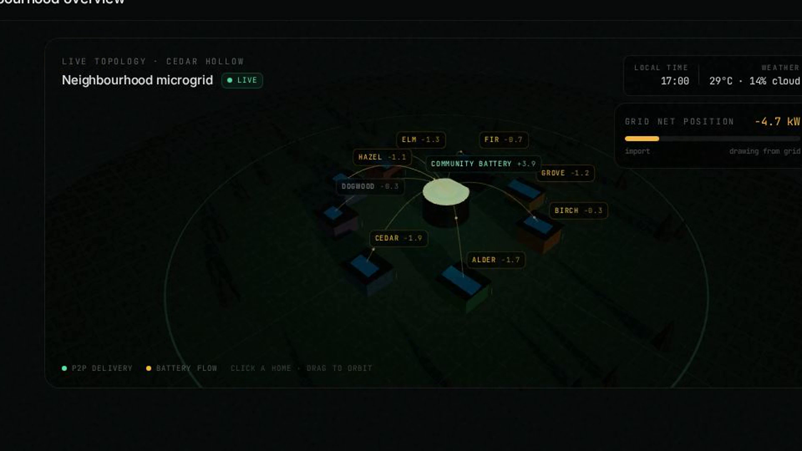
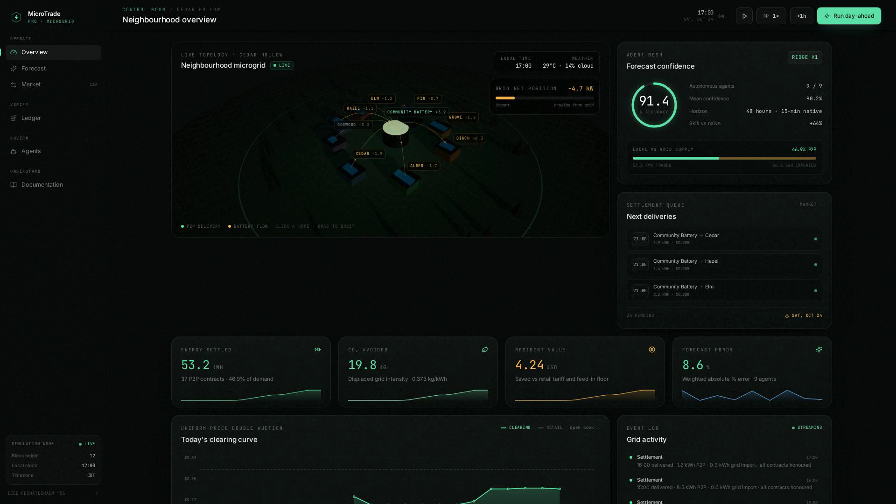
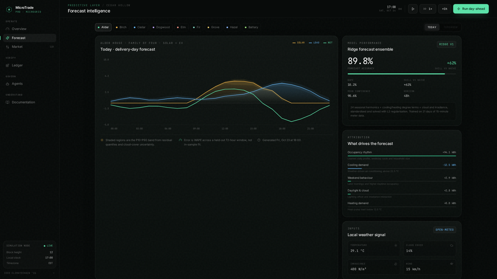
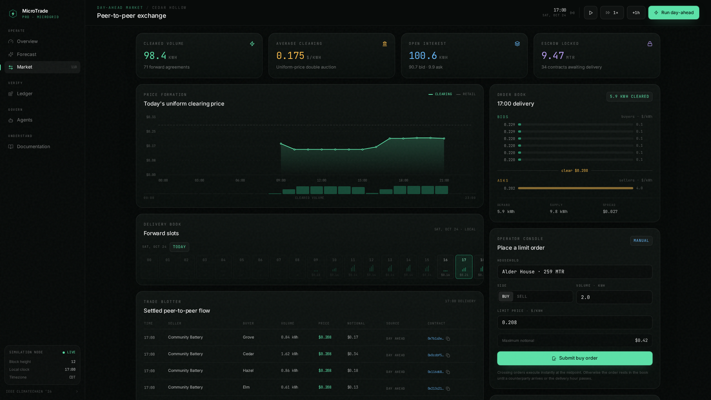
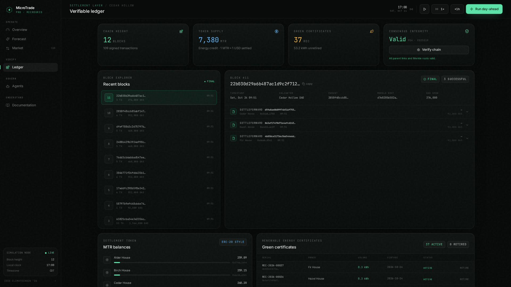
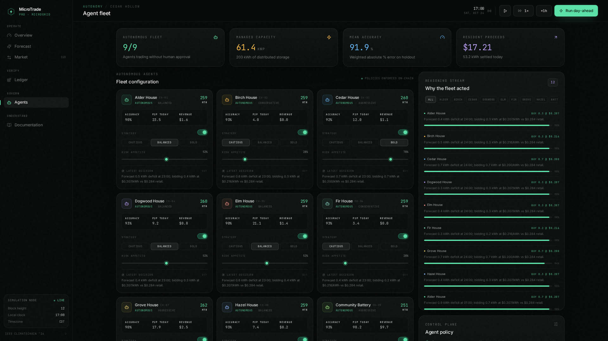

# MicroTrade Pro — Devpost submission copy

> Paste into Devpost. Images resolve on GitHub via relative paths; in Devpost,
> re-upload the same files from `docs/images/` or swap in `raw.githubusercontent`
> URLs after push. Demo video: upload the MP4 in `demo/film/renders/` to YouTube
> and replace `YOUTUBE_URL` below.

## Tagline

Sunlight, traded next door — predictive peer-to-peer energy trading for neighborhood microgrids.

## Demo video

▶ https://www.youtube.com/watch?v=YOUTUBE_URL (2:13 — hook, live app tour, on-chain proof)

## Inspiration

Most rooftop solar is wasted — exported for pennies while the evening peak is bought
back at full price. The grid takes its cut both ways, and the carbon savings are never
counted. We wanted a market where a neighborhood trades sunlight with itself, settled
fairly and verifiably.

## What it does

MicroTrade Pro turns a 9-home neighborhood into an autonomous power market. Each home
runs a forecasting agent that predicts its own supply and demand, bids into a day-ahead
auction, signs forward contracts, and settles delivery — with every green kilowatt-hour
retired as an auditable climate claim.

**Predict.** Every agent trains its own ridge-ensemble model on three weeks of meter
history plus live weather, publishing 48-hour load and solar curves with honest
uncertainty bands — about 10% error, 62% better than guessing.

**Trade.** Each morning the agents bid into a uniform-price double auction. One clearing
price per hour. Matched trades become forward contracts: the buyer escrows payment, the
seller stakes a 12% bond that is slashed if the sun doesn't deliver.

**Settle.** Delivery is metered hourly against the contract. Escrow releases, shortfalls
slash bonds, and each delivered green kWh mints a GreenREC. The ledger is a signed,
Merkle-committed chain — and the same contracts live on a public testnet (below).

**Agents.** Nine autonomous household agents — forecasters, market makers, a battery
operator — coordinate the whole day while you sleep.

## The smart contracts — deployed, not vaporware

The settlement layer is real Solidity, deployed on public testnets. V2 is the hardened
build: reentrancy guard, staked seller bonds via `depositBond`, unfunded-crowding
protection via `cancelUnfunded`, oracle-gated settlement and minting, zeroed balances
before external calls. Full sources in `contracts/` (MIT).

- **V2 `MicroTradeEnergyV2` on Base Sepolia (chain 84532)** — headline deployment
  `0x45C0Be734cF808fcab42E285F33a7a811cc8EB00`
- V2 mirror on Ethereum Sepolia (chain 11155111) — `0x2f7EbFA1942B97F74D428226CcA48dD643794E78`
- V1 `MicroTradeEnergy` on Ethereum Sepolia — `0x8d1e4ad61a2e4071707b512473652924b8E4c914`
  (tagged `sepolia-v1`; demo-grade, bond not escrowed)

Honest scope: these are testnet deployments, self-reviewed and hardened — not a
third-party audit. The code is open, the chains are public, and every claim above is
checkable on-chain.

## How we built it

React + Three.js live 3D microgrid, Node/Express deterministic simulation engine,
dependency-free ridge regression, Ed25519-signed PoA ledger, Solidity V2 on Base
Sepolia. Demo film cut with Hyperframes from real app capture, voiced with Deepgram.

## What's next

Mainnet pilot with a real community battery, Chainlink oracle feeds for settlement,
third-party audit of V2, and mobile metering via smart-plug integrations.

## Links

- Live demo: https://microtrade-pro.onrender.com/
- Code: this repo (MIT — see LICENSE)
- Contracts: Base Sepolia `0x45C0Be734cF808fcab42E285F33a7a811cc8EB00`
